# Аннотация

Работа во время учёбы стала обычной частью студенческой жизни, но её последствия для образования оцениваются противоречиво. В статье проверяется, в каких аспектах совмещение учёбы и работы приносит студентам пользу, а в каких создаёт трудности. Данные получены в третьей и четвёртой волнах опроса КИВО, когда респонденты учились на третьем и четвёртом курсах (рабочий массив — 2 022 человека, из них 715 ответили в обеих волнах). Проверены 25 направленных гипотез о связи наличия, формата и объёма работы, а также опыта стажировок с успеваемостью, удовлетворённостью обучением, мыслями об отчислении, воспринимаемой пользой и трудностями работы, сном и физической активностью. Использовались логистическая и порядковая логистическая регрессия и линейная регрессия с устойчивыми ошибками. Пропуски в социальных характеристиках и рабочих часах восстанавливались методом цепочек уравнений, множественные проверки корректировались методом Холма. Наличие и объём работы не связаны ни с оценками, ни с удовлетворённостью обучением. Польза зависит от содержания работы: каждый пункт шкалы соответствия работы специальности повышает шансы оценить работу как полезную для учёбы в 2,3 раза. Трудности зависят от условий работы: их чаще отмечают студенты с большой нагрузкой и те, кто работает ради того, чтобы себя содержать. Намерение искать работу предсказывает трудоустройство через год. Результаты описывают связи, а не причинные эффекты.

**Ключевые слова:** студенческая занятость, совмещение учёбы и работы, соответствие работы специальности, стажировки, успеваемость, панельный опрос, множественное восстановление пропусков.

# 1. Введение

Около половины студентов российских вузов работают во время учёбы (Рощин, Рудаков, 2014). Вуз и сами студенты при этом понимают совмещение по-разному. Одни считают, что работа отнимает время у учёбы и ухудшает успеваемость. Другие видят в ней источник опыта и связей, полезных после выпуска. Эмпирические исследования поддерживают обе позиции: в одних работах объём работы связан с более низкими оценками (Stinebrickner & Stinebrickner, 2003), в других связь слабая или отсутствует (Darolia, 2014; Riggert et al., 2006).

Мы исходим из того, что ответ на вопрос «вредна ли работа» зависит от характеристик самой работы. Поэтому исследование построено вокруг вопроса: **в каких аспектах совмещение учёбы и работы приносит студентам пользу, а в каких создаёт дополнительные трудности?** Он разбит на семь исследовательских вопросов (ИВ):

- ИВ1 — структура и социальные различия занятости;
- ИВ2 — занятость и обучение;
- ИВ3 — воспринимаемая польза и трудности работы;
- ИВ4 — опыт стажировок;
- ИВ5 — занятость и здоровье (сон, спорт, курение, алкоголь);
- ИВ6 — планы распределения времени и трудоустройства;
- ИВ7 — изменения между третьим и четвёртым курсом.

Вклад работы состоит в трёх вещах. Во-первых, польза и трудности измерены у одних и тех же студентов отдельно, и можно проверить, исключают ли они друг друга. Во-вторых, данные двух волн позволяют сопоставить планы студентов с их последующей занятостью. В-третьих, анализ построен так, чтобы его выводы не зависели от способа обработки пропусков: каждая модель оценивалась в четырёх вариантах.

# 2. Обзор литературы

## 2.1. Работа как конкурент учёбы и как её дополнение

В исследованиях студенческой занятости сложились две основные позиции. Согласно первой, время на работу и время на учёбу конкурируют: каждый рабочий час отнимается у занятий, поэтому с ростом нагрузки успеваемость снижается. Согласно второй, работа и учёба могут дополнять друг друга, если работа развивает навыки, нужные в учёбе, или повышает мотивацию. Тривенти сопоставляет эти позиции с гипотезами отбора: в работу могут приходить как более сильные, так и более слабые студенты, и тогда различие между работающими и неработающими объясняется не работой, а исходными различиями (Triventi, 2014).

Обзор Риггерта с соавторами показывает, что результаты эмпирических работ противоречат друг другу и сильно зависят от того, как измерены занятость и успеваемость (Riggert et al., 2006). Исследования, учитывающие отбор, чаще находят отрицательный эффект только при большой нагрузке. В квазиэксперименте на данных колледжа Береа дополнительные рабочие часы снижали оценки (Stinebrickner & Stinebrickner, 2003). На американских панельных данных для студентов очной формы эффект работы на средний балл оказался небольшим (Darolia, 2014). На итальянских данных существенный отрицательный эффект показывала прежде всего интенсивная занятость (Triventi, 2014).

## 2.2. Характеристики работы

Если эффект зависит от нагрузки, естественно предположить, что он зависит и от содержания работы. Гель и Бакес-Гельнер показали, что выгоды студенческой занятости на рынке труда после выпуска — более короткий поиск работы и более высокая зарплата — получают только студенты, работавшие по специальности (Geel & Backes-Gellner, 2012). Крид с соавторами разделили выгоды работы и её требования: у австралийских студентов выгоды связаны с большей вовлечённостью в учёбу, а требования — с худшим самочувствием (Creed et al., 2015). Отсюда следует, что польза и трудности — разные измерения опыта совмещения и их стоит измерять отдельно.

## 2.3. Российский контекст

По данным Рощина и Рудакова, вероятность совмещения у российских студентов выше в ведущих вузах, в магистратуре, у мужчин и при отсутствии финансовой поддержки семьи (Рощин, Рудаков, 2014). Совмещение связано с более высокой вероятностью занятости после выпуска и с зарплатной премией, но эта отдача зависит от качества образования и от того, насколько близко к выпуску студент начал работать (Рожкова и др., 2024). Массовую студенческую занятость отмечают и в других постсоветских странах: в Эстонии учёба для многих студентов стала, по выражению авторов, «подработкой» при основной занятости (Beerkens et al., 2011).

Из обзора следуют три ожидания, которые проверяются в статье. Отрицательные последствия работы должны концентрироваться при высокой нагрузке. Польза должна зависеть от соответствия работы специальности. Студенты, вынужденные работать ради заработка, должны чаще сталкиваться с трудностями совмещения.

# 3. Данные и методы

## 3.1. Источник данных и выборка

Использованы ответы третьей и четвёртой волн опроса КИВО, собранные, когда респонденты учились на третьем и четвёртом курсах. Исходный массив содержал 5 831 запись и 82 переменные. Идентификатора респондента в выгрузке нет: ответы обеих волн одного участника записаны в одной строке.[^id] Из исследования исключались только записи без единого ответа на исследуемые вопросы (3 809 записей, почти все без признака участия в какой-либо волне). Рабочий массив составил 2 022 записи: 509 участников только третьей волны, 798 — только четвёртой и 715 — обеих волн (табл. 1).

[^id]: Повторные записи выявлялись по полному совпадению ответов. Совпадения с другой записью при 15 и более заполненных вопросах найдены у восьми строк (четыре пары). Различить повторную отправку анкеты и случайное совпадение ответов разных людей по этим данным нельзя, поэтому записи сохранены и отмечены флагом качества.

**Таблица 1.** *Состав рабочего массива и основные аналитические выборки*

| Группа | n |
|---|---|
| Рабочий массив | 2 022 |
| участники только 3-й волны | 509 |
| участники только 4-й волны | 798 |
| участники обеих волн | 715 |
| Ответили о работе, 3-я волна | 1 204 |
| Ответили о работе, 4-я волна | 904 |
| Работающие, 3-я волна | 531 |
| Работающие, 4-я волна | 438 |
| Проходившие стажировку, 3-я волна | 241 |
| Участники обеих волн, не работавшие в 3-й волне | 338 |
| Работавшие в обеих волнах | 153 |

*Примечание.* Объёмы выборок отдельных проверок приведены в приложении Б.

У 599 участников четвёртой волны есть ответы об обучении, но нет ответа о работе. Среди них 574 записи повторяют один из двух одинаковых профилей ответов, что указывает на возможный технический сбой анкеты.[^profiles] Эти записи не исключались, но в анализ связей с занятостью четвёртой волны не входят, поскольку ответа о работе у них нет.

[^profiles]: Профиль A (327 записей) и профиль B (247 записей) обрываются после четырёх вопросов об обучении. При случайном совпадении ожидалось бы 7,6 и 3,6 таких записи (односторонний биномиальный тест, p < 0,001). Ответы в профилях также не согласуются с ответами тех же людей в третьей волне. Это указывает на техническое происхождение записей, но не доказывает его.

## 3.2. Переменные

*Занятость.* Формат текущей работы (нет работы, нерегулярные подработки, неполный и полный рабочий день), рабочие часы за прошлую неделю, сфера, мотив трудоустройства и оценка соответствия работы специальности (шкала 1–4).

*Оценки работы.* Работающим четвёртой волны предлагалось согласиться или не согласиться (шкала 1–4) с тремя утверждениями: работа помогает усваивать учебный материал (польза), из-за работы страдает успеваемость (ущерб), совмещать учёбу и работу очень трудно (трудности). Такие же вопросы задавались о стажировках в третьей волне.

*Обучение.* Самооценка успеваемости (четыре категории — от «в основном удовлетворительные» до «только отличные»), удовлетворённость обучением, мысли об отчислении и их причины, повторный выбор вуза и специальности.

*Здоровье и образ жизни.* Ночной интервал сна в будни и выходные, рассчитанный по времени отбоя и подъёма, сдвиг середины сна между буднями и выходными, занятия спортом и их частота, курение и употребление алкоголя.

*Планы.* Планируемое распределение времени между учёбой, работой и другими занятиями (в процентах), намерение неработающих искать работу.

*Социальные характеристики.* Пол, укрупнённое направление подготовки, форма финансирования обучения (бюджет, платное, целевое) и материальное положение семьи (шкала 1–6).

## 3.3. Подготовка данных

Каждому ответу по логике переходов анкеты присваивался статус: содержательный ответ, специальный ответ («затрудняюсь ответить», отказ, «другое»), логически невозможное значение, пропуск показанного вопроса, отсутствие ответа после прерывания анкеты, структурная неприменимость или неучастие в волне (ср. AAPOR, 2023; Groves et al., 2009). Пустой ответ не трактовался как отказ. Специальные ответы входили в описательную статистику отдельными категориями и исключались только из моделей с порядковым исходом. Их частота не различалась по полу, направлению, финансированию, участию в панели и формату занятости (все скорректированные p ≥ 0,12; критерий χ² или перестановочный тест, V Крамера; Agresti, 2013).

Значения не удалялись, а получали двумерный флаг качества по аналогии со схемой Delft-FEWS (Deltares, n.d.). Флаг объединяет происхождение значения (исходное, исправленное, восстановленное) и его надёжность (надёжное, сомнительное, ненадёжное). Сомнительными считались возможные, но необычные значения: выход рабочих часов за границы по правилу Тьюки (Tukey, 1977; Iglewicz & Hoaglin, 1993), нулевые часы у работающих, ночной интервал короче 4 или длиннее 12 часов, противоречия между ответами. Ненадёжными — логически невозможные значения, например более 168 рабочих часов в неделю. Схема флагов приведена в приложении В.

## 3.4. Пропуски и их восстановление

Материальное положение семьи не указали 34,6% участников третьей волны, форму финансирования — 22,7%. Пропуск зависел от направления подготовки и пола (LR χ²(8) = 91,7 и 133,8; p < 0,001), но не от оценок, удовлетворённости и занятости (все p > 0,24). Это противоречит предположению о полностью случайном пропуске (MCAR) и согласуется с предположением о случайном пропуске при учёте наблюдаемых переменных (MAR; Rubin, 1976). При таком механизме анализ только полных случаев смещал бы состав выборки по направлениям подготовки, а множественное восстановление даёт несмещённые оценки (Little & Rubin, 2019; van Buuren, 2018).

Восстанавливались только социальные характеристики и рабочие часы работающих. Использовался метод цепочек уравнений (van Buuren & Groothuis-Oudshoorn, 2011):

- для бинарных переменных — логистическая регрессия;
- для номинальных — мультиномиальная регрессия;
- для порядковых и непрерывных — предсказательное сопоставление средних с пятью донорами (Little, 1988b).

Для малых категорий применялся слабый L2-штраф, предотвращающий полное разделение (White et al., 2010).[^mice] Модель восстановления должна включать все переменные модели анализа (Meng, 1994), поэтому восстановление выполнялось отдельно в семи наборах, соответствующих семействам моделей. Число восстановленных наборов (41–62) выбиралось как 100 × доля неполных записей, но не менее 20 (Bodner, 2008). Зависимые переменные входили в модели восстановления как предикторы (Little, 1992), но записи без наблюдённого исхода в модели гипотез не включались (von Hippel, 2007). Оценки объединялись по правилам Рубина (Rubin, 1987) со степенями свободы Барнарда — Рубина (Barnard & Rubin, 1999).

[^mice]: В Python нет готового аналога R-пакета `mice` для номинальных переменных, поэтому цепочки уравнений реализованы на NumPy и SciPy. Без штрафа оценки мультиномиальной модели совпадают с оценками `statsmodels.MNLogit`.

## 3.5. Модели

Метод выбирался по типу зависимой переменной (табл. 2). Для порядковых исходов использовалась модель пропорциональных шансов, поскольку оценки и шкалы согласия представляют упорядоченные категории с неравными промежутками (Long, 1997).[^po] Рабочие часы вводились линейно, эффект приводится на 10 часов в неделю. Набор поправок для каждой гипотезы задан заранее; общий набор включает пол, направление, финансирование и материальное положение семьи. Гипотезы проверялись отдельно в каждой волне: ответы 715 участников обеих волн не независимы, и объединять волны в одной модели нельзя.

[^po]: Предположение о пропорциональности шансов проверялось отдельными логистическими моделями для каждого порога шкалы. Если отношения шансов по порогам расходились по направлению, это отмечалось в результатах.

**Таблица 2.** *Методы анализа по типу зависимой переменной*

| Зависимая переменная | Примеры | Метод | Мера эффекта |
|---|---|---|---|
| Бинарная | наличие работы, мысли об отчислении, спорт | логистическая регрессия | OR, 95% ДИ |
| Порядковая (1–4) | оценки, удовлетворённость, польза, трудности | порядковая логистическая регрессия | OR, 95% ДИ |
| Непрерывная | ночной интервал сна, сдвиг середины сна | МНК с ошибками HC3 | b (часы), 95% ДИ |
| Номинальная | мотивы, повторный выбор | χ² или перестановочный тест, V Крамера | доли, 95% ДИ Уилсона |

Каждая модель оценивалась в четырёх вариантах:

- A — восстановленные данные (основной вариант);
- B — полные случаи;
- C — полные случаи без поправки на материальное положение;
- D — вариант A без сомнительных значений.

Вывод считался устойчивым, если в вариантах B–D он совпадал с выводом основного варианта. Ориентиром достаточной численности служили 10 событий более редкого исхода (для логистической модели) или 10 наблюдений (для остальных моделей) на оцениваемый параметр (Long, 1997). Если численности не хватало, поправки сокращались до пола и направления.

## 3.6. Проверка гипотез

Тесты двусторонние, α = 0,05. Поправка Холма (Holm, 1979) применялась отдельно внутри каждой гипотезы: если гипотеза проверялась в двух волнах или имела дополнительные контрасты, их p-значения корректировались вместе.[^holm] Гипотеза считалась подтверждённой, если направление эффекта совпадало с ожидаемым и скорректированное p было меньше 0,05 в основном варианте во всех волнах проверки. Если это выполнялось в одной из двух волн, гипотеза считалась подтверждённой частично. Исследовательские задачи (З) носят разведочный характер: для них приводятся доли и средние с 95% доверительными интервалами без поправки на множественность.

[^holm]: Например, в Г2.3 сравнение работающих полный день с неработающими корректировалось вместе со сравнениями неполного дня и подработок с неработающими — всего шесть проверок в двух волнах. Решение по гипотезе принималось по основному контрасту.

План анализа с методами для каждой гипотезы составлен до проверки гипотез.[^plan] Расчёты выполнены в Python 3.14 (pandas, NumPy, SciPy, statsmodels).

[^plan]: При отладке функции объединения оценок до составления плана была оценена одна модель — связь часов с удовлетворённостью в четвёртой волне (Г2.2). Методы этой гипотезы выбраны по тем же общим правилам, что и для остальных.

# 4. Результаты

## 4.1. Структура занятости (ИВ1)

Работали 44% студентов на третьем курсе и 48% на четвёртом (рис. 1). Подработки и неполный рабочий день встречались примерно одинаково часто (около 20% каждый), доля работающих полный день выросла с 4% до 9%. Занятость оказалась неустойчивой: 40% подрабатывавших на третьем курсе к четвёртому не работали, а из 20 работавших полный день этот формат сохранили 8.

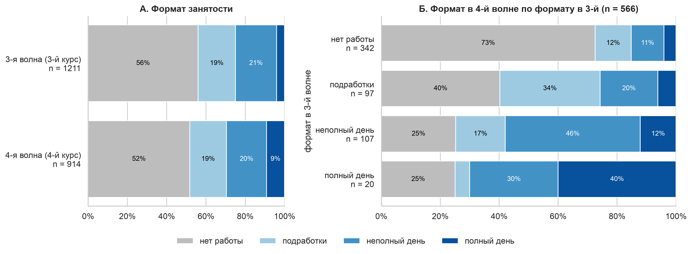

Медиана рабочих часов росла от подработок (8–9 часов в неделю) к неполному (20) и полному рабочему дню (35), но распределения форматов сильно перекрывались (рис. 2). Поэтому формат и число часов рассматривались как разные характеристики занятости.

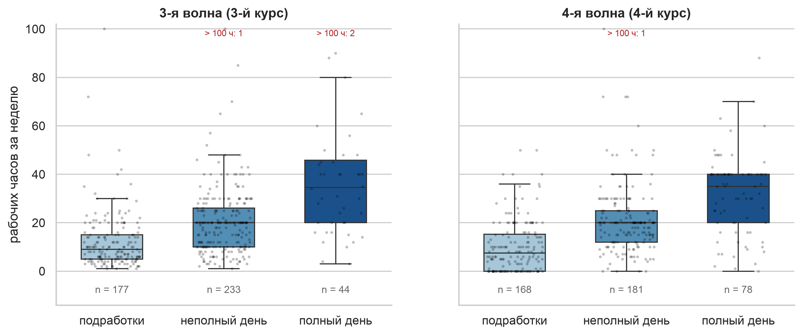

Главными мотивами работы были содержание себя (34% и 38% работающих) и дополнительный доход (34% и 28%). Оплату обучения назвали 2–3% работающих, и даже среди студентов платной формы — лишь единицы. Наличие работы не связано ни с формой финансирования (Г1.2: OR = 1,00 [0,69; 1,46] и 0,93 [0,60; 1,45]), ни с материальным положением семьи (Г1.3: OR = 0,99 [0,87; 1,12] и 1,07 [0,91; 1,26]). Мотив содержания себя на третьем курсе несколько чаще называли студенты из менее обеспеченных семей, но на четвёртом курсе этот градиент не повторился (Г1.4: OR = 0,89 и 0,92; p = 0,18 и 0,51).

## 4.2. Занятость и обучение (ИВ2)

Рабочие часы не связаны с категорией оценок (Г2.1: OR = 1,05 [0,96; 1,15] и 0,97 [0,86; 1,09] на 10 часов) и с удовлетворённостью обучением (Г2.2: OR = 0,93 [0,84; 1,03] и 0,98 [0,86; 1,13]). Эти выводы сохраняются во всех вариантах анализа.

Работающие полный день чаще задумывались об отчислении: 53% и 52% против 40% и 39% среди неработающих (Г2.3: OR = 1,81 [0,99; 3,32] и 1,77 [1,09; 2,87]). Направление совпадает с гипотезой, но после поправки Холма различие незначимо (p = 0,22 и 0,10). Группа полного дня мала (49 и 84 человека).

Изменилась и структура причин мыслей об отчислении (рис. 3). Трудности совмещения учёбы и работы называли около 70% работающих полный день и 10–18% неработающих. Учебные причины (академические трудности, разочарование в направлении) у работающих полный день, напротив, встречались реже. С ростом часов доля называющих трудности совмещения увеличивалась: с 39% до 66% на третьем курсе и с 48% до 77% на четвёртом (Г2.4: OR = 1,18 [1,01; 1,39] и 1,24 [1,00; 1,55]). Без поправки эффект значим, но после поправки Холма — нет (p = 0,077 в обеих волнах).

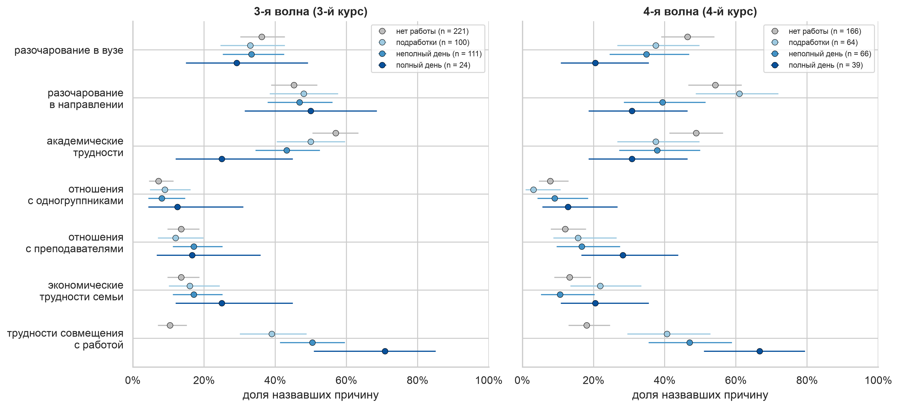

Повторный выбор вуза и специальности не зависел от формата занятости. С соответствием работы специальности он связан тесно: «тот же вуз, ту же специальность» выбрали бы 37% студентов, чья работа совсем не соответствует специальности, и 60% при полном соответствии.

## 4.3. Польза и трудности работы (ИВ3)

Польза и трудности работы зависели от разных характеристик. Соответствие работы специальности оказалось самым сильным фактором воспринимаемой пользы: каждый пункт шкалы соответствия повышал шансы более высокой оценки пользы в 2,3 раза (Г3.1: OR = 2,28 [1,89; 2,75], p < 0,001; n = 376). Согласие с тем, что работа помогает учёбе, выросло с 34% при полном несоответствии до 87% при полном соответствии. На оценку ущерба успеваемости соответствие не повлияло (Г3.2: OR = 0,94 [0,79; 1,12]).

Трудности определялись условиями работы. Каждые 10 рабочих часов повышали шансы более высокой оценки трудностей совмещения в 1,2 раза (Г3.3: OR = 1,20 [1,05; 1,37], p по Холму = 0,008), причём рост сосредоточен в группе с нагрузкой свыше 30 часов. У работающих ради содержания себя и оплаты обучения шансы более высокой оценки трудностей были в 2,5 раза выше, чем у работающих ради опыта и интереса, при равных часах и соответствии специальности (Г3.5: OR = 2,52 [1,53; 4,15], p < 0,001; рис. 4). Мотив опыта не давал дополнительной пользы сверх соответствия специальности (Г3.4: OR = 1,58 [0,96; 2,61], p = 0,072).

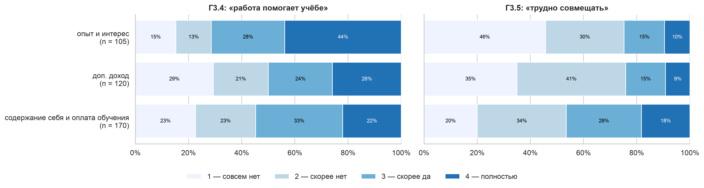

Польза и трудности не исключают друг друга (рис. 5). Только пользу отмечали 40% работающих, только трудности — 16%, оба аспекта сразу — 18%. Доля отмечающих только пользу росла с 24% при полном несоответствии работы специальности до 66% при полном соответствии, а доля отмечающих только трудности снижалась с 27% до 5%.

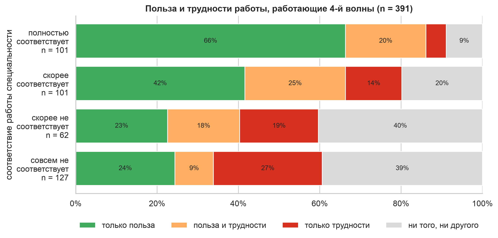

Субъективная оценка ущерба согласуется с самоотчётной успеваемостью. Среди согласных с тем, что из-за работы страдает успеваемость, в основном удовлетворительные оценки получают 28–30% студентов, среди несогласных — 12–13% (З3.8: OR = 0,66 [0,54; 0,80]).[^z38]

[^z38]: Это разведочная задача, а не гипотеза. Результат показывает, что студенты в целом адекватно оценивают последствия работы, но направление связи не установлено: студенты с низкими оценками могут объяснять их работой.

## 4.4. Опыт стажировок (ИВ4)

Стажировки проходили 20% студентов к третьему курсу и 28% к четвёртому. Чаще стажировались работающие студенты (30% против 12% на третьем курсе), мужчины, студенты инженерных и общественных направлений. Для стажировок, как и для работы, решающим оказалось соответствие направлению обучения (рис. 6). При полном соответствии 48% студентов полностью согласны с тем, что стажировка помогает учёбе, при меньшем соответствии — 6–10% (Г4.2: OR = 2,94 [2,11; 4,11]). Соответствующие направлению стажировки реже вредили успеваемости (Г4.3: OR = 0,58 [0,43; 0,78]). Обе гипотезы подтвердились во всех вариантах анализа.

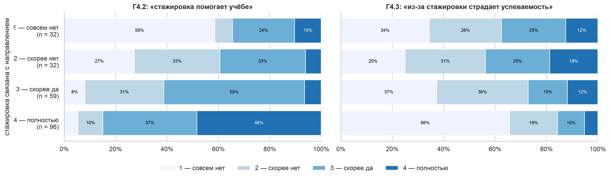

Выбравшие стажировку ради опыта или интереса чаще видели её пользу, чем выбравшие её ради дохода (73% против 48%; Г4.4: OR = 2,13 [1,07; 4,22], p = 0,031). В анализе полных случаев этот результат не воспроизводится, поэтому его следует считать неустойчивым. Оплачиваемые и неоплачиваемые стажировки оценивались сходно, но выбирались по разным мотивам: неоплачиваемые — ради опыта (65% против 43%), оплачиваемые — чаще ради дохода.

## 4.5. Занятость и здоровье (ИВ5)

На третьем курсе каждые 10 рабочих часов были связаны с сокращением ночного интервала сна в будни на 0,15 часа, или около 9 минут (Г5.1: b = −0,15 [−0,28; −0,02], p по Холму = 0,044; рис. 7). На четвёртом курсе связи нет (b = −0,05 [−0,17; 0,07]), а без сомнительных значений сна эффект третьего курса исчезает (b = −0,08 [−0,20; 0,04]). Гипотеза подтверждается частично, вывод неустойчив. Сдвиг середины сна между буднями и выходными с нагрузкой не связан (Г5.2).

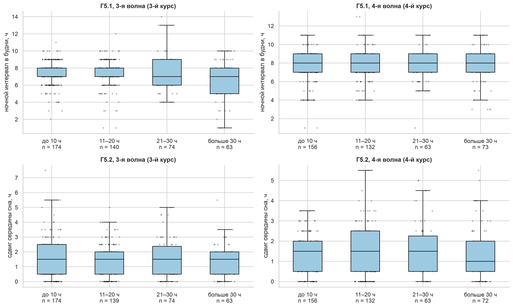

Работа не вытесняла спорт. На третьем курсе доли занимающихся спортом среди работающих и неработающих почти одинаковы (69–75%). На четвёртом курсе работающие полный день занимались спортом даже чаще неработающих (61–69% против 54%; Г5.3: OR = 1,75 [1,06; 2,88]), то есть в направлении, противоположном гипотезе. Частота занятий с часами не связана (Г5.4: OR = 0,94 [0,81; 1,08]).

В разведочном анализе работающие курили чаще неработающих (24–36% против 19%; для работающих полный день OR = 2,35 [1,22; 4,54] и 2,02 [1,16; 3,53]). Употребление алкоголя у работающих тоже было несколько выше (54–66% против 49–53%).[^smoke]

[^smoke]: Связь с курением получена без поправки на множественность. По этим данным нельзя установить, начали ли студенты курить после начала работы или курили и раньше.

## 4.6. Планы и последующая занятость (ИВ6)

В планах распределения времени студенты отводили учёбе в среднем половину времени. Оплачиваемую работу не планировали 44%, а среди планировавших медианная доля составила около четверти времени (приложение А, рис. А3). Планируемая доля росла вместе с форматом текущей занятости: от 0 у неработающих до 40% у работающих полный день.

Среди не работавших на третьем курсе планы предсказывали занятость на четвёртом (рис. 8). Намеревавшиеся искать работу через год работали почти вдвое чаще остальных: 38% против 20% (Г6.2: OR = 2,81 [1,62; 4,88], p < 0,001; n = 338). Студенты, отводившие работе положительную долю времени, работали чаще тех, кто не отводил ей времени (38% против 23%; Г6.3: OR = 1,98 [1,15; 3,40], p = 0,013). Планы распределения времени не были связаны с последующими оценками и удовлетворённостью.

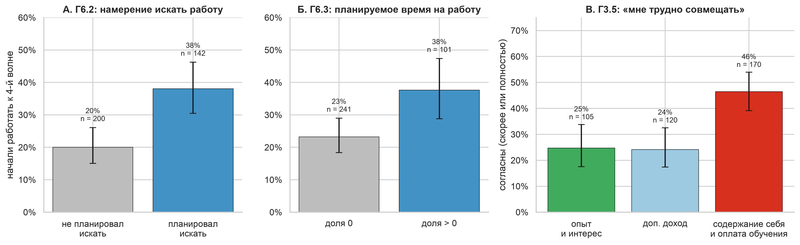

## 4.7. Изменения между волнами (ИВ7)

Среди участников обеих волн с ответом о работе 44% не работали ни на третьем, ни на четвёртом курсе, 17% начали работать, 13% прекратили и 27% работали в обеих волнах. С учётом исходного уровня начало работы не сопровождалось снижением удовлетворённости (Г7.2: OR = 1,13 [0,66; 1,96]) или оценок (Г7.3: OR = 0,93 [0,56; 1,54]). Начавшие работать уже на третьем курсе были удовлетворены обучением больше остальных: студенты, выходящие на работу, изначально отличаются от неработающих. Изменение рабочих часов не связано с изменением сна (Г7.4: b = 0,03 [−0,19; 0,26] на 10 часов). Стажировка не ускоряла выход на работу: среди не работавших на третьем курсе начали работать 28% стажировавшихся и 27% не стажировавшихся (Г7.5: OR = 0,93 [0,41; 2,12]).

Разведочный анализ дал два результата, требующих проверки. Начали курить 15% начавших работать против 2% оставшихся неработающими (p < 0,001). Мысли об отчислении впервые возникли у 33% работавших в обеих волнах против 12–17% в других группах (p = 0,006).

## 4.8. Сводка

Из 25 гипотез подтвердились 8, частично — одна, не подтвердились 16 (табл. 3). Четыре вывода неустойчивы к способу обработки данных: Г2.3, Г2.4, Г4.4 и Г5.1.

**Таблица 3.** *Результаты проверки гипотез (основной вариант)*

| Гипотеза | Эффект: 3-я / 4-я волна | Решение | Устойчиво |
|---|---|---|---|
| Г1.2 платное обучение → работа | OR 1,00 / 0,93 | не подтверждается | да |
| Г1.3 материальное положение → работа | OR 0,99 / 1,07 | не подтверждается | да |
| Г1.4 материальное положение → мотив «содержать себя» | OR 0,89 / 0,92 | не подтверждается | да |
| Г2.1 часы → оценки | OR 1,05 / 0,97 | не подтверждается | да |
| Г2.2 часы → удовлетворённость | OR 0,93 / 0,98 | не подтверждается | да |
| Г2.3 полный день → мысли об отчислении | OR 1,81 / 1,77 | не подтверждается¹ | нет |
| Г2.4 часы → причина «трудности совмещения» | OR 1,18 / 1,24 | не подтверждается¹ | нет |
| Г3.1 соответствие специальности → польза | OR 2,28 | **подтверждается** | да |
| Г3.2 соответствие специальности → меньше ущерба | OR 0,94 | не подтверждается | да |
| Г3.3 часы → трудности совмещения | OR 1,20 | **подтверждается** | да |
| Г3.4 мотив опыта → польза | OR 1,58 | не подтверждается | да |
| Г3.5 мотив содержания себя → трудности | OR 2,52 | **подтверждается** | да |
| Г4.2 соответствие стажировки → польза | OR 2,94 | **подтверждается** | да |
| Г4.3 соответствие стажировки → меньше ущерба | OR 0,58 | **подтверждается** | да |
| Г4.4 мотив стажировки → польза | OR 2,13 | **подтверждается** | нет |
| Г5.1 часы → сон в будни | b −0,15 / −0,05 ч | **частично** | нет |
| Г5.2 часы → сдвиг середины сна | b −0,06 / 0,04 ч | не подтверждается | да |
| Г5.3 полный день → реже спорт | OR 0,98 / 1,75 | не подтверждается² | да |
| Г5.4 часы → частота спорта | OR 0,94 | не подтверждается | да |
| Г6.2 намерение искать работу → работа | OR 2,81 | **подтверждается** | да |
| Г6.3 время на работу в планах → работа | OR 1,98 | **подтверждается** | да |
| Г7.2 начало работы → удовлетворённость | OR 1,13 | не подтверждается | да |
| Г7.3 начало работы → оценки | OR 0,93 | не подтверждается | да |
| Г7.4 изменение часов → изменение сна | b 0,03 ч | не подтверждается | да |
| Г7.5 стажировка → выход на работу | OR 0,93 | не подтверждается | да |

*Примечание.* Эффекты часов приведены на 10 часов в неделю. «Устойчиво» — тот же вывод в вариантах B–D. Доверительные интервалы и p-значения приведены в приложении Г.
¹ Направление совпадает с гипотезой, но после поправки Холма эффект незначим.
² В 4-й волне эффект значим в противоположном направлении.

# 5. Обсуждение

Главный результат исследования: польза и трудности совмещения определяются характером занятости, а не самим фактом работы. Наличие работы, её формат и объём не связаны с успеваемостью и удовлетворённостью обучением. Это согласуется с выводами о слабом среднем эффекте работы на успеваемость (Darolia, 2014; Riggert et al., 2006) и противоречит представлению о работе как о прямом конкуренте учёбы.

При этом работа меняет опыт учёбы. Польза зависит от содержания работы: соответствие специальности — самый сильный и устойчивый эффект исследования, причём одинаково для работы и для стажировок. Это совпадает с выводом о том, что выгоды студенческой занятости на рынке труда получают только работающие по специальности (Geel & Backes-Gellner, 2012). Трудности зависят от условий: от нагрузки и от того, вынужденная ли это работа. Разделение пользы и трудностей как двух независимых измерений согласуется с моделью выгод и требований работы (Creed et al., 2015). Почти каждый пятый работающий отмечает и то и другое.

Нагрузка проявляется не в оценках, а в трудностях совмещения и в причинах мыслей об отчислении. У работающих полный день трудности совмещения становятся главной причиной таких мыслей и частично вытесняют учебные причины. Этот результат совместим с выводами о вреде именно интенсивной занятости (Triventi, 2014). Однако в нашей выборке группа полного дня мала, и соответствующие гипотезы (Г2.3, Г2.4) не прошли поправку на множественность.

Социальное положение не объясняет, кто работает. В отличие от данных Рощина и Рудакова (2014), отсутствие финансовой поддержки, измеренное материальным положением семьи, в нашей выборке с наличием работы не связано. Различие может объясняться другим составом выборки и другим измерением: в КИВО материальное положение оценивается по шкале самооценки, и у трети участников оно пропущено.

Трудоустройство в значительной мере планируемо. Намерение искать работу почти втрое повышает шансы работать через год, а стажировка на выход на работу не влияет. Начавшие работать изначально были удовлетворены учёбой больше остальных. Это согласуется с гипотезой положительного отбора в работу (Triventi, 2014) и предостерегает от сравнения работающих и неработающих без учёта исходного уровня.

## 5.1. Ограничения

1. **Наблюдательный дизайн.** Все результаты описывают связи. Например, студенты, удовлетворённые выбором специальности, могут чаще искать работу по ней, а не работа по специальности повышать удовлетворённость.
2. **Выбывание.** Ответ о работе в обеих волнах есть у 46% участников третьей волны. Оставшиеся немного лучше учились и реже работали (|SMD| = 0,16–0,19; Stuart, 2010), поэтому межволновые результаты относятся к более успешной части студентов.
3. **Пропуски социальных характеристик.** Они восстановлены при предположении MAR. Основные выводы подтверждаются и в анализе полных случаев.
4. **Малые группы.** Работающих полный день — 49 и 84 человека, работавших в обеих волнах с данными о сне — 127. Отсутствие значимого эффекта в таких группах означает отсутствие сильного эффекта; слабый эффект исключить нельзя.
5. **Измерение.** Все показатели самоотчётные. Оценки измерены категориями, сон — интервалом между отбоем и подъёмом. Вопросы о мыслях об отчислении и о стажировках охватывают весь период обучения и могут относиться ко времени до текущей работы.

# 6. Заключение

Совмещение учёбы и работы у студентов третьего и четвёртого курсов не ухудшает успеваемость и удовлетворённость обучением. Польза работы зависит от её соответствия специальности, а трудности — от нагрузки свыше 30 часов в неделю и от вынужденности работы. Здоровье и образ жизни работа затрагивает слабо: связь с сокращением сна обнаружена только на третьем курсе и неустойчива, спорт работа не вытесняет.

Для вузов отсюда следуют три практических вывода. Поддержка трудоустройства по специальности (базы практик, партнёрства с работодателями, зачёт работы по профилю) может усиливать пользу совмещения. Студентам с большой нагрузкой и тем, кто работает ради заработка на жизнь, может требоваться гибкий график и индивидуальная траектория. Ограничивать студенческую занятость по полученным данным оснований нет.

Дальнейшие исследования должны проверить разведочные результаты (курение у начавших работать, мысли об отчислении при длительной занятости) на независимых данных, измерить успеваемость средним баллом и собрать сведения о сроках начала работы и стажировок, чтобы установить последовательность событий.

# Заявление об использовании ИИ-инструментов

При подготовке данных, программировании анализа и подготовке текста автор использовал ассистента Claude (Anthropic). Все решения о методах, интерпретация результатов и окончательная редакция текста принадлежат автору. Код анализа и протокол очистки данных доступны в блокнотах `cleaning.ipynb`, `analysis.ipynb` и `figures.ipynb`.

# Список литературы

AAPOR. (2023). *Standard definitions: Final dispositions of case codes and outcome rates for surveys* (10th ed.). American Association for Public Opinion Research.

Agresti, A. (2013). *Categorical data analysis* (3rd ed.). Wiley.

Barnard, J., & Rubin, D. B. (1999). Small-sample degrees of freedom with multiple imputation. *Biometrika, 86*(4), 948–955. https://doi.org/10.1093/biomet/86.4.948

Beerkens, M., Mägi, E., & Lill, L. (2011). University studies as a side job: Causes and consequences of massive student employment in Estonia. *Higher Education, 61*(6), 679–692. https://doi.org/10.1007/s10734-010-9356-0

Bodner, T. E. (2008). What improves with increased missing data imputations? *Structural Equation Modeling, 15*(4), 651–675. https://doi.org/10.1080/10705510802339072

Creed, P. A., French, J., & Hood, M. (2015). Working while studying at university: The relationship between work benefits and demands and engagement and well-being. *Journal of Vocational Behavior, 86*, 48–57. https://doi.org/10.1016/j.jvb.2014.11.002

Darolia, R. (2014). Working (and studying) day and night: Heterogeneous effects of working on the academic performance of full-time and part-time students. *Economics of Education Review, 38*, 38–50. https://doi.org/10.1016/j.econedurev.2013.10.004

Deltares. (n.d.). *Data quality flags*. Delft-FEWS documentation. https://publicwiki.deltares.nl/spaces/FEWSDOC/pages/217121527/Data+quality+flags

Geel, R., & Backes-Gellner, U. (2012). Earning while learning: When and how student employment is beneficial. *Labour, 26*(3), 313–340. https://doi.org/10.1111/j.1467-9914.2012.00548.x

Groves, R. M., Fowler, F. J., Couper, M. P., Lepkowski, J. M., Singer, E., & Tourangeau, R. (2009). *Survey methodology* (2nd ed.). Wiley.

Holm, S. (1979). A simple sequentially rejective multiple test procedure. *Scandinavian Journal of Statistics, 6*(2), 65–70.

Iglewicz, B., & Hoaglin, D. C. (1993). *How to detect and handle outliers*. ASQC Quality Press.

Little, R. J. A. (1988a). A test of missing completely at random for multivariate data with missing values. *Journal of the American Statistical Association, 83*(404), 1198–1202. https://doi.org/10.1080/01621459.1988.10478722

Little, R. J. A. (1988b). Missing-data adjustments in large surveys. *Journal of Business & Economic Statistics, 6*(3), 287–296. https://doi.org/10.1080/07350015.1988.10509663

Little, R. J. A. (1992). Regression with missing X's: A review. *Journal of the American Statistical Association, 87*(420), 1227–1237. https://doi.org/10.1080/01621459.1992.10476282

Little, R. J. A., & Rubin, D. B. (2019). *Statistical analysis with missing data* (3rd ed.). Wiley.

Long, J. S. (1997). *Regression models for categorical and limited dependent variables*. Sage.

Meng, X.-L. (1994). Multiple-imputation inferences with uncongenial sources of input. *Statistical Science, 9*(4), 538–558. https://doi.org/10.1214/ss/1177010269

Riggert, S. C., Boyle, M., Petrosko, J. M., Ash, D., & Rude-Parkins, C. (2006). Student employment and higher education: Empiricism and contradiction. *Review of Educational Research, 76*(1), 63–92. https://doi.org/10.3102/00346543076001063

Rubin, D. B. (1976). Inference and missing data. *Biometrika, 63*(3), 581–592. https://doi.org/10.1093/biomet/63.3.581

Rubin, D. B. (1987). *Multiple imputation for nonresponse in surveys*. Wiley.

Stinebrickner, R., & Stinebrickner, T. R. (2003). Working during school and academic performance. *Journal of Labor Economics, 21*(2), 473–491. https://doi.org/10.1086/345565

Stuart, E. A. (2010). Matching methods for causal inference: A review and a look forward. *Statistical Science, 25*(1), 1–21. https://doi.org/10.1214/09-STS313

Triventi, M. (2014). Does working during higher education affect students' academic progression? *Economics of Education Review, 41*, 1–13. https://doi.org/10.1016/j.econedurev.2014.03.006

Tukey, J. W. (1977). *Exploratory data analysis*. Addison-Wesley.

van Buuren, S. (2018). *Flexible imputation of missing data* (2nd ed.). CRC Press.

van Buuren, S., & Groothuis-Oudshoorn, K. (2011). mice: Multivariate imputation by chained equations in R. *Journal of Statistical Software, 45*(3), 1–67. https://doi.org/10.18637/jss.v045.i03

von Hippel, P. T. (2007). Regression with missing Ys: An improved strategy for analyzing multiply imputed data. *Sociological Methodology, 37*(1), 83–117. https://doi.org/10.1111/j.1467-9531.2007.00180.x

White, I. R., Daniel, R., & Royston, P. (2010). Avoiding bias due to perfect prediction in multiple imputation of incomplete categorical variables. *Computational Statistics & Data Analysis, 54*(10), 2267–2275. https://doi.org/10.1016/j.csda.2010.04.005

Рожкова, К. В., Рощин, С. Ю., & Травкин, П. В. (2024). От совмещения учебы с работой к совмещению работы с учебой? Изменение модели российского высшего образования. *Вопросы образования*, (2), 286–322. https://doi.org/10.17323/vo-2024-17242

Рощин, С. Ю., & Рудаков, В. Н. (2014). Совмещение учебы и работы студентами российских вузов. *Вопросы образования*, (2), 152–179. https://doi.org/10.17323/1814-9545-2014-2-152-179

# Приложение А. Дополнительные рисунки

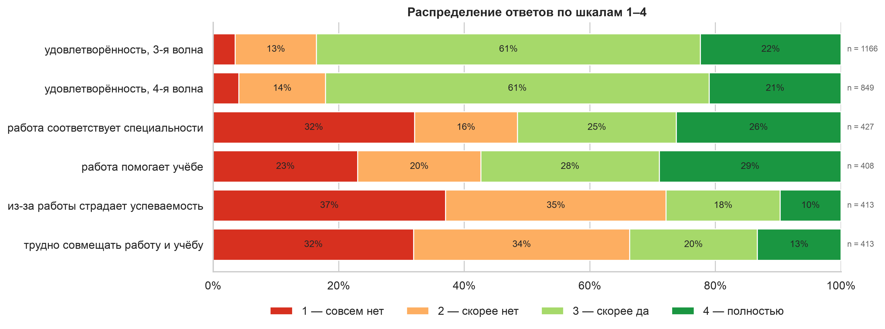

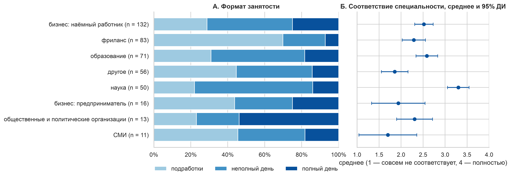

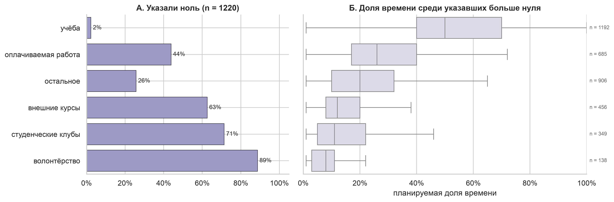

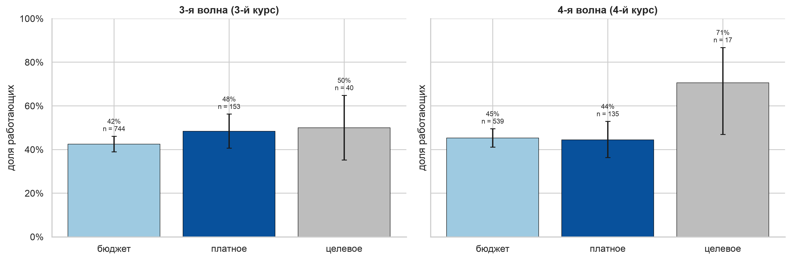

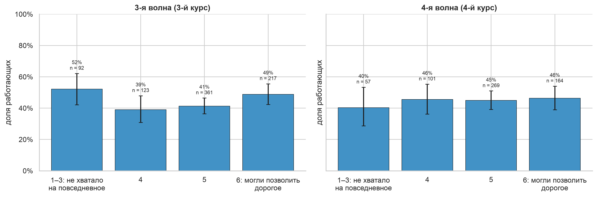

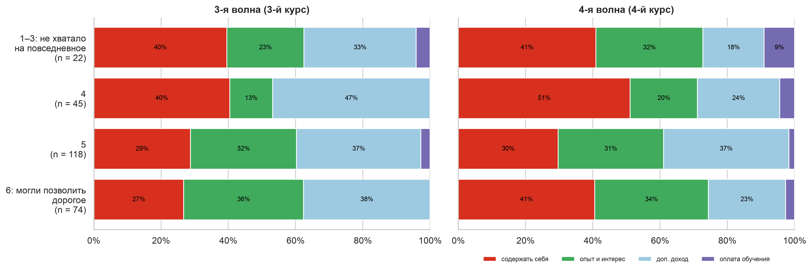

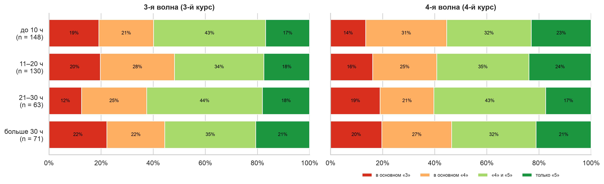

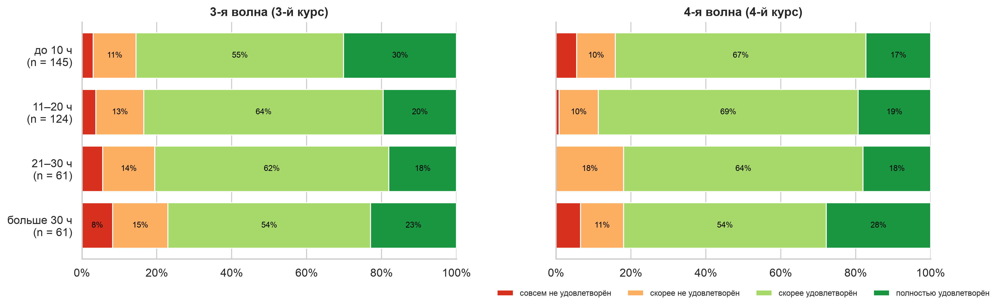

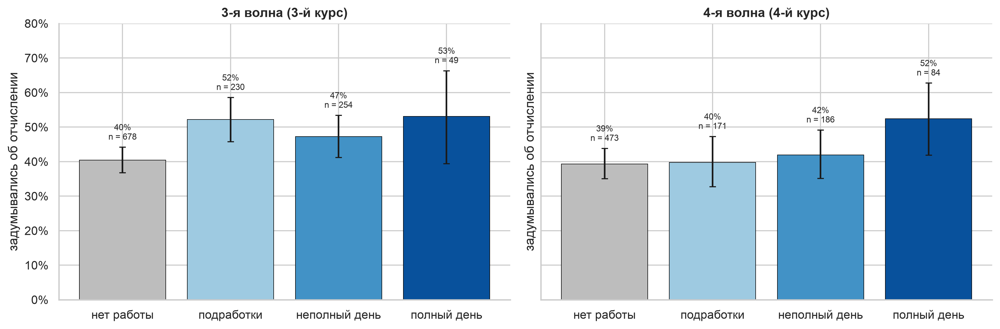

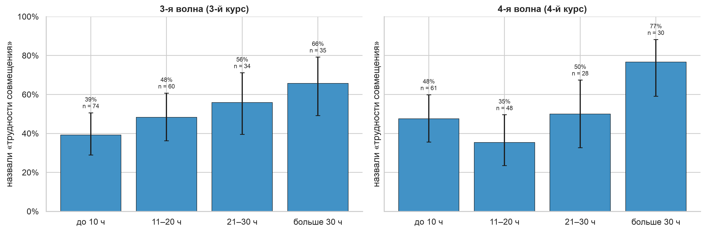

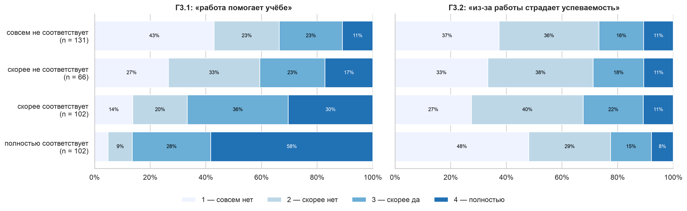

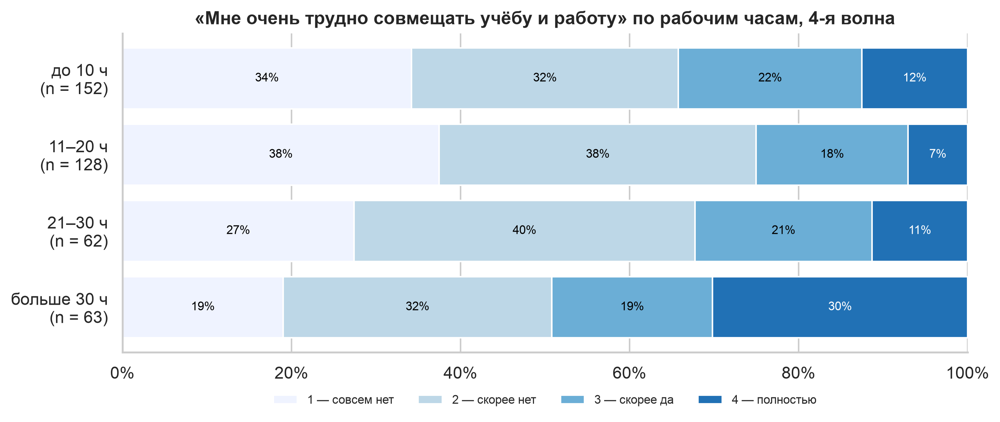

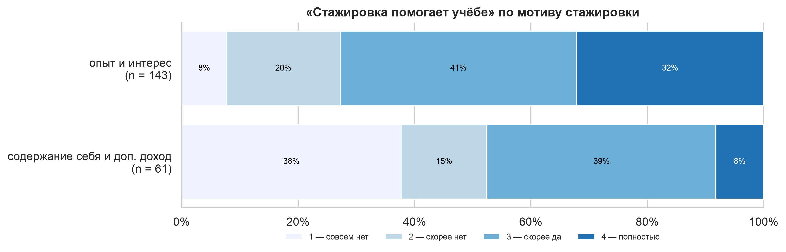

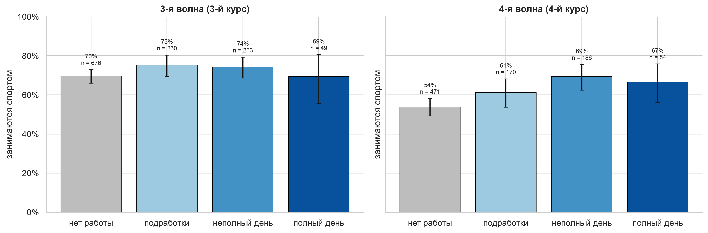

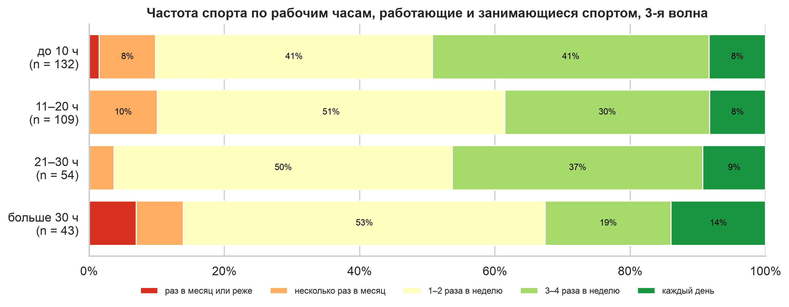

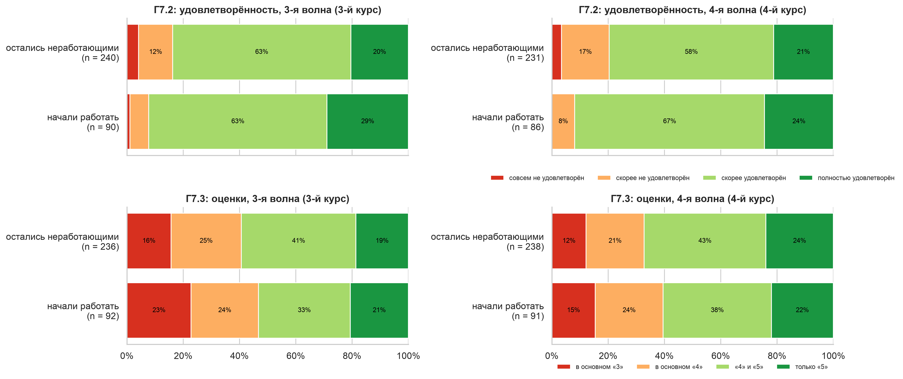

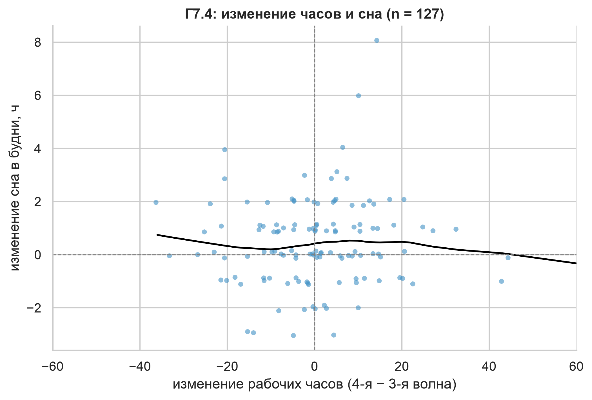

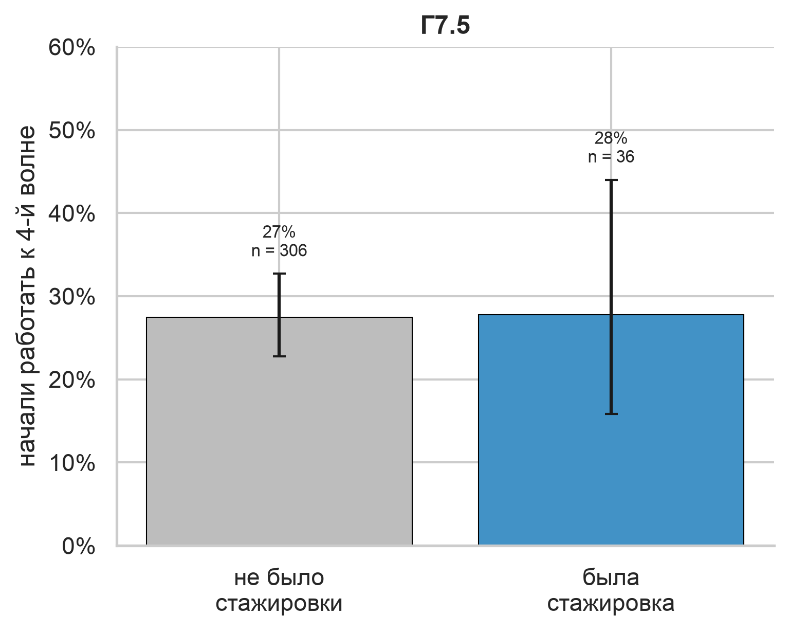

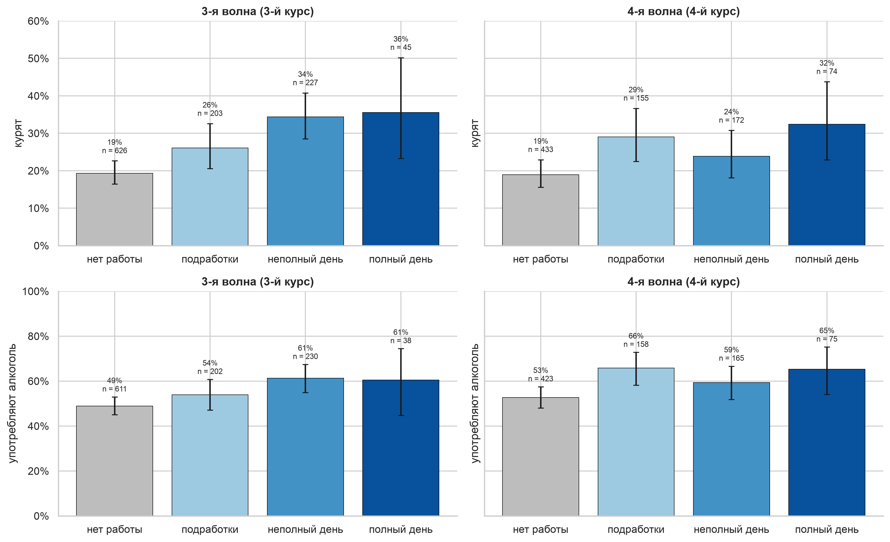

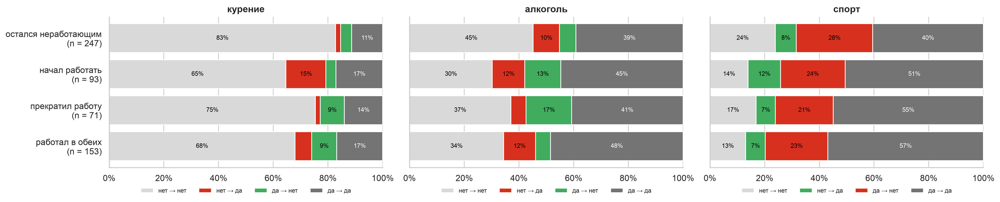

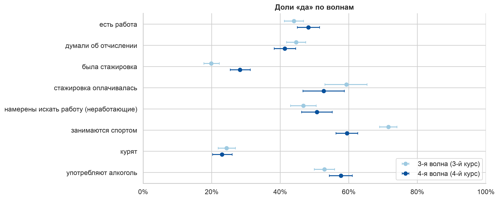

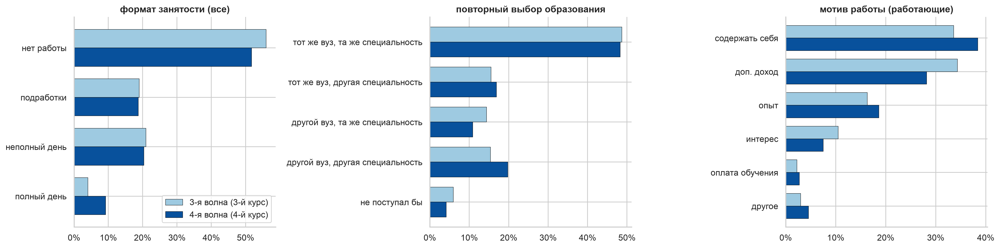

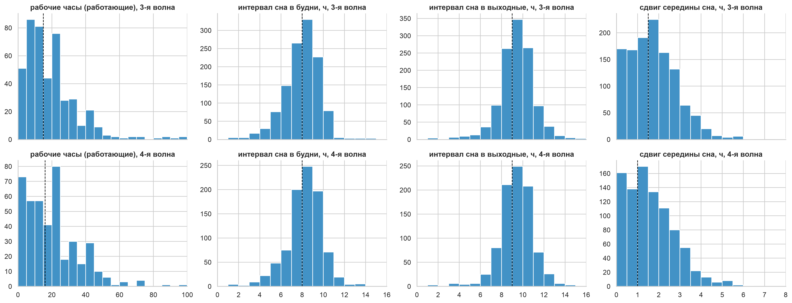

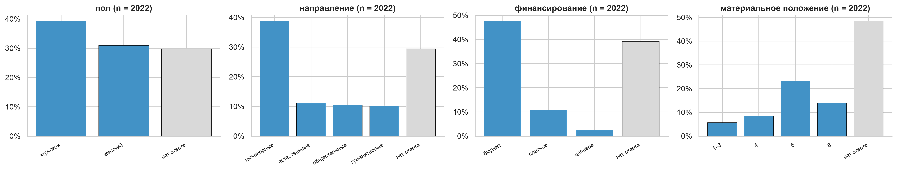

# Приложение Б. Объёмы выборок отдельных проверок

| Проверка | По необходимым переменным | Со всеми поправками | После восстановления (вариант A) |
|---|---|---|---|
| Г1.2, 3-я / 4-я волна | 897 / 674 | 742 / 560 | 1 151 / 876 |
| Г1.3, 3-я / 4-я волна | 793 / 591 | 776 / 573 | 1 204 / 904 |
| Г1.4, 3-я / 4-я волна | 342 / 259 | 337 / 253 | 516 / 417 |
| Г2.1, 3-я / 4-я волна | 444 / 412 | 281 / 245 | 514 / 421 |
| Г2.2, 3-я / 4-я волна | 432 / 391 | 273 / 234 | 505 / 400 |
| Г2.3, 3-я / 4-я волна | 727 / 557 | 461 / 370 | 722 / 550 |
| Г2.4, 3-я / 4-я волна | 203 / 176 | 132 / 104 | 235 / 168 |
| Г3.1 | 397 | 220 | 376 |
| Г3.2 | 401 | 224 | 380 |
| Г3.3 | 405 | 224 | 382 |
| Г3.4 | 389 | 220 | 376 |
| Г3.5 | 395 | 224 | 382 |
| Г4.2 | 217 | 118 | 202 |
| Г4.3 | 219 | 116 | 204 |
| Г4.4 | 204 | 118 | 202 |
| Г5.1, 3-я / 4-я волна | 451 / 424 | 285 / 247 | 528 / 433 |
| Г5.2, 3-я / 4-я волна | 450 / 423 | 285 / 246 | 527 / 431 |
| Г5.3, 3-я / 4-я волна | 725 / 555 | 460 / 369 | 720 / 548 |
| Г5.4 | 338 | 208 | 393 |
| Г6.2 | 342 | 236 | 338 |
| Г6.3 | 342 | 236 | 338 |
| Г7.2 | 307 | 211 | 304 |
| Г7.3 | 319 | 220 | 315 |
| Г7.4 | 127 | 86 | 152 |
| Г7.5 | 342 | 236 | 338 |

*Примечание.* Вариант A может быть больше выборки «по необходимым переменным», так как в нём восстановлены социальные характеристики и рабочие часы.

# Приложение В. Схема флагов качества

| Код | Значение | Использование |
|---|---|---|
| 0 | исходное, надёжное | основной анализ |
| 1 | исправленное, надёжное (открытый ответ однозначно перенесён в закрытую категорию) | основной анализ |
| 2 | восстановленное, надёжное | основной анализ по восстановленным наборам |
| 3–5 | исходное, исправленное или восстановленное, но сомнительное | основной анализ; исключается в варианте D |
| 6 | исходное, ненадёжное | не используется |
| 9 | пропуск | не используется |
| 99 | вопрос не применим (в том числе ответ вне маршрута анкеты) | — |

*Примечание.* Сомнительными отмечены 25 значений рабочих часов в третьей волне и 80 в четвёртой (из них 51 — нулевые часы). Все 27 ненадёжных значений часов восстановлены.

# Приложение Г. Оценки моделей с доверительными интервалами

| Гипотеза, волна | n (A) | Оценка [95% ДИ] | p | p по Холму |
|---|---|---|---|---|
| Г1.2, 3-я | 1 151 | OR 1,00 [0,69; 1,46] | 0,987 | 1,000 |
| Г1.2, 4-я | 876 | OR 0,93 [0,60; 1,45] | 0,745 | 1,000 |
| Г1.3, 3-я | 1 204 | OR 0,99 [0,87; 1,12] | 0,826 | 0,826 |
| Г1.3, 4-я | 904 | OR 1,07 [0,91; 1,26] | 0,387 | 0,775 |
| Г1.4, 3-я | 516 | OR 0,89 [0,75; 1,05] | 0,175 | — |
| Г1.4, 4-я | 417 | OR 0,92 [0,72; 1,17] | 0,507 | — |
| Г2.1, 3-я | 514 | OR 1,05 [0,96; 1,15] | 0,300 | 0,599 |
| Г2.1, 4-я | 421 | OR 0,97 [0,86; 1,09] | 0,562 | 0,599 |
| Г2.2, 3-я | 505 | OR 0,93 [0,84; 1,03] | 0,150 | 0,299 |
| Г2.2, 4-я | 400 | OR 0,98 [0,86; 1,13] | 0,788 | 0,788 |
| Г2.3, 3-я | 722 | OR 1,81 [0,99; 3,32] | 0,054 | 0,22 |
| Г2.3, 4-я | 550 | OR 1,77 [1,09; 2,87] | 0,021 | 0,10 |
| Г2.4, 3-я | 235 | OR 1,18 [1,01; 1,39] | 0,038 | 0,077 |
| Г2.4, 4-я | 168 | OR 1,24 [1,00; 1,55] | 0,049 | 0,077 |
| Г3.1 | 376 | OR 2,28 [1,89; 2,75] | < 0,001 | < 0,001 |
| Г3.2 | 380 | OR 0,94 [0,79; 1,12] | 0,465 | 0,465 |
| Г3.3 | 382 | OR 1,20 [1,05; 1,37] | 0,008 | 0,008 |
| Г3.4 | 376 | OR 1,58 [0,96; 2,61] | 0,072 | — |
| Г3.5 | 382 | OR 2,52 [1,53; 4,15] | < 0,001 | < 0,001 |
| Г4.2 | 202 | OR 2,94 [2,11; 4,11] | < 0,001 | < 0,001 |
| Г4.3 | 204 | OR 0,58 [0,43; 0,78] | < 0,001 | < 0,001 |
| Г4.4 | 202 | OR 2,13 [1,07; 4,22] | 0,031 | 0,031 |
| Г5.1, 3-я | 528 | b −0,15 [−0,28; −0,02] | 0,022 | 0,044 |
| Г5.1, 4-я | 433 | b −0,05 [−0,17; 0,07] | 0,408 | 0,408 |
| Г5.2, 3-я | 527 | b −0,06 [−0,12; −0,00] | 0,041 | 0,082 |
| Г5.2, 4-я | 431 | b 0,04 [−0,06; 0,14] | 0,410 | 0,410 |
| Г5.3, 3-я | 720 | OR 0,98 [0,52; 1,88] | 0,963 | — |
| Г5.3, 4-я | 548 | OR 1,75 [1,06; 2,88] | 0,028 | — |
| Г5.4 | 393 | OR 0,94 [0,81; 1,08] | 0,388 | 0,388 |
| Г6.2 | 338 | OR 2,81 [1,62; 4,88] | < 0,001 | < 0,001 |
| Г6.3 | 338 | OR 1,98 [1,15; 3,40] | 0,013 | 0,013 |
| Г7.2 | 304 | OR 1,13 [0,66; 1,96] | 0,652 | 0,652 |
| Г7.3 | 315 | OR 0,93 [0,56; 1,54] | 0,787 | 0,787 |
| Г7.4 | 152 | b 0,03 [−0,19; 0,26] | 0,783 | 0,783 |
| Г7.5 | 338 | OR 0,93 [0,41; 2,12] | 0,863 | — |

*Примечание.* OR — отношение шансов; b — коэффициент линейной регрессии в часах сна. Эффекты рабочих часов — на 10 часов в неделю, шкал — на один пункт. Прочерк означает, что p по Холму в сводной таблице блокнота не выводился; решение по этим гипотезам от поправки не зависит: исходное p ≥ 0,05 (Г1.4, Г3.4, Г5.3 в 3-й волне, Г7.5), эффект направлен против гипотезы (Г5.3 в 4-й волне) либо p < 0,001 при единственной проверке (Г3.5).
